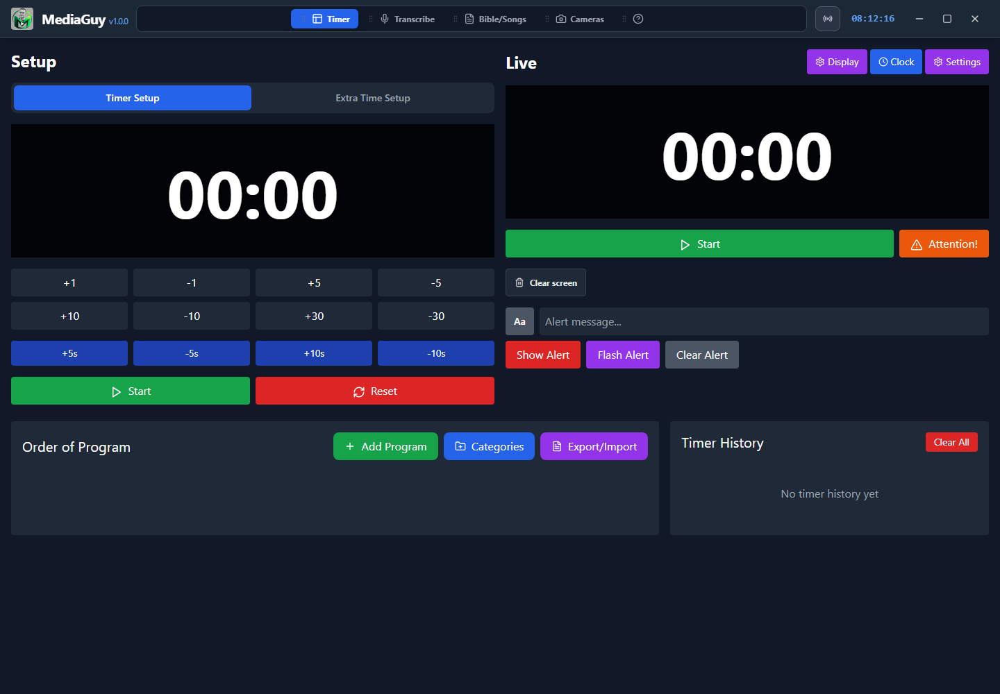

# MediaGuy

**An open-source toolkit for the people who make church services happen.**

MediaGuy brings service timing, presentation, remote operation, and camera workflows together for church media teams. It is an actively evolving project: the goal is to grow it into a practical, complete solution for church media operators, with input from the people using it every week.

> **Project status:** The desktop app is the primary application. Song projection is temporarily disabled while the Bible presentation workflow is refined, and Broadcast Overlay has been removed for now. The Android companion now sends video-only camera frames to the desktop mixer; it is still an early implementation.

[](docs/screenshots/timer-dashboard.png)

## Features

### Desktop app

- **Service timer:** Build and organize a service run of show, group programs into categories, reorder items, and control live countdowns. Includes timer history, attention and alert controls, clock display, and an autopilot queue with configurable transitions.
- **Projection:** Send the timer and Bible passages to a selected display. Adjust presentation styles and use image, video, webcam, or connected-camera backgrounds where supported.
- **Bible and song library:** Browse and search the included King James Version (KJV) text and present passages. Save, edit, search, preview, and organize song slides in the library; song projection is temporarily disabled while the Bible presentation workflow is being developed.
- **Transcription:** Capture live speech through the selected microphone, edit and search the transcript, and download it. Optional AI-assisted content planning can create an editable seven-day social plan and downloadable images; it does not publish content automatically.
- **Camera mixer:** Connect browser-based or Android phone cameras, preview sources, choose a program feed, send messages to camera operators, and use a camera feed as a timer or Bible background.
- **Remote operation:** Open the desktop app's remote interface on a phone, tablet, or computer for supported timer, Bible, transcription, and display controls.
- **Local-first data:** App data and settings are kept on the desktop. MediaGuy does not provide built-in account-based cloud sync.

### Android companion

The Android project is called **Church Guy** in the app launcher and **MediaGuy Camera** on its connection screen. It is intended as a phone-camera companion, not as an Android version of the desktop controls.

To connect, start Remote Access on the desktop and use **Auto-Detect MediaGuy on Network** in the Android app. Select the discovered desktop to retrieve its camera-only invitation token automatically; no QR scan or manual token entry is needed, and the remote-control PIN is not exposed. The app locks to landscape while live and instructs the phone holder to enable Auto-rotate and hold the phone sideways. Its on-screen framing guide is local preview only and is not included in video sent to the PC. The companion sends JPEG video frames and supports stage messages, but currently sends no audio.

Android frames are relayed through the desktop app to the camera mixer and timer/Bible display clients. This JPEG-over-WebSocket path is video-only and less efficient than the browser camera's WebRTC path; performance depends on the network and device.

## Getting Started

### Desktop requirements

- Windows 10 or later is the simplest supported development and packaging workflow.
- Node.js and npm.
- Git.
- For live speech transcription: Google Chrome, microphone access, and an internet connection.
- For AI-assisted content planning: a GitHub token configured in the app and internet access.

### Run the desktop app from source

```powershell
git clone https://github.com/johnbenet009/mediaguy.git
cd mediaguy
npm install
npm --prefix vite-core install
npm run dev
```

`npm run dev` builds the Vite frontend and then launches Electron. To run Electron against the current built files in `public`, use `npm start`. After changing frontend code, rebuild with `npm run build` before starting Electron. For frontend-only iteration, use `npm run dev-vite`.

### Build desktop packages

On Windows, create an installer or an unpacked app with:

```powershell
npm run build-installer
npm run build-clean
```

Linux packaging scripts are included (`build-linux`, `build-linux-clean`, and `build-linux-appimage`), but the shared frontend build currently uses Windows `xcopy`; Linux packaging may need that step adapted. A macOS packaging target is not currently configured.

### Build the Android companion

Install Android Studio with the Android SDK Platform 37 and a JDK supported by the Android Gradle Plugin (JDK 17 or newer), then from PowerShell:

```powershell
cd AndroidApp
.\gradlew.bat :app:assembleDebug
```

The debug APK is written to `AndroidApp/app/build/outputs/apk/debug/app-debug.apk`. With an Android device connected and USB debugging enabled, install it with:

```powershell
.\gradlew.bat :app:installDebug
```

The app supports Android 7.0 (API 24) and later. To build a release APK, use `:app:assembleRelease`; release builds enable code shrinking and may need release signing configured before distribution.

## Remote Access and Security

Remote access is designed for trusted networks. The desktop server generates and requires a random eight-digit access PIN by default; the host can reveal it in the Remote Access window and replace it with a PIN of at least eight characters. The interface and local WebSocket use **unencrypted HTTP**, so the PIN and remote traffic can be observed by someone with access to the network.

- Do not expose the local remote server directly to the public internet.
- Share the access PIN only with intended operators. Camera invitations are camera-only links and do not grant timer control; treat their QR codes and URLs as private while active.
- Five failed PIN attempts from one address within five minutes trigger a one-minute cooldown. This limits casual guessing but does not make the unencrypted LAN server suitable for public exposure.
- Local Wi-Fi camera connections require the phone and desktop to be on the same trusted network.
- Online camera mode creates a temporary Cloudflare HTTPS tunnel. Stop the tunnel when it is no longer needed; direct video can still be affected by restrictive networks.

The Android app uses cleartext networking for local HTTP/WebSocket connections. The phone browser camera workflow requires a secure context for camera access; use the app's Online HTTPS mode when a browser on the phone cannot access its camera over local HTTP.

## Development

Run the standard quality checks from the repository root:

```powershell
npm run check
npm run build
```

GitHub Actions runs these checks and builds the Android companion on pushes and pull requests.

Android unit tests and debug build:

```powershell
cd AndroidApp
.\gradlew.bat :app:testDebugUnitTest :app:assembleDebug
```

The project is organized as follows:

```text
main.js                 Electron main process and desktop services
preload.js              Renderer-to-Electron API bridge
remote-server.js        Local HTTP and WebSocket remote server
public/                 Built frontend served by Electron and remote devices
vite-core/src/          React and TypeScript desktop interface
AndroidApp/             Kotlin and Jetpack Compose camera companion
docs/                   Project documentation and screenshots
```

## Contributing

Ideas, bug reports, documentation improvements, and code contributions are welcome. **Our mission is to make MediaGuy a more complete, dependable toolkit for church media teams**, and the people running services are an important part of deciding what to build next.

- Open an issue to report a problem, suggest an improvement, or request a feature. Include your operating system, app version, steps to reproduce, and what you expected to happen.
- For a substantial change, open an issue first so we can discuss the approach and make sure it fits the project's direction.
- Fork the repository, make your change on a branch, and open a pull request with a clear summary and the checks you ran. We review contributions for usefulness, quality, and fit; a pull request may need changes before it can be merged.
- Developers are encouraged to pull the project, try it, leave a comment, and give it a star if it is useful to them.

Please do not include access PINs, camera invitation links, private network details, personal information, or copyrighted lyrics shared without permission in issues, screenshots, or pull requests.

## License

MediaGuy is released under the [MIT License](LICENSE.txt). You are welcome to use, fork, modify, and redistribute it under the terms of that license.

